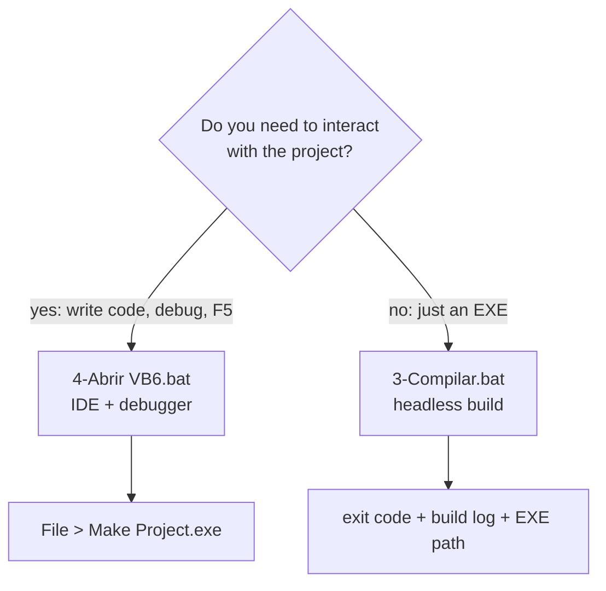
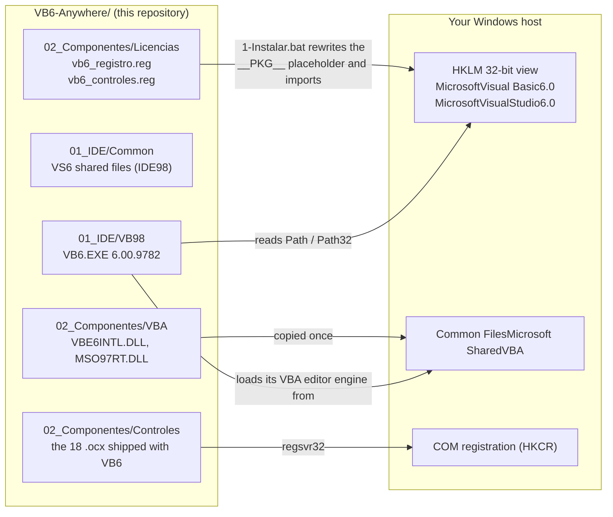
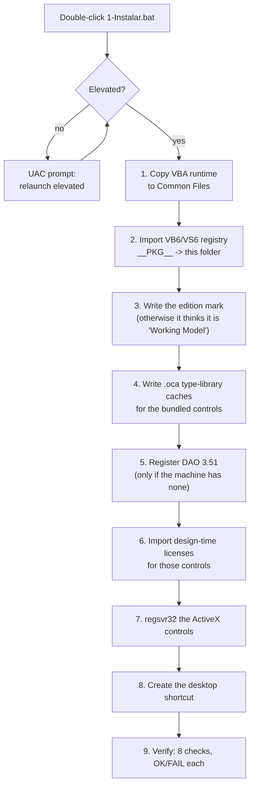
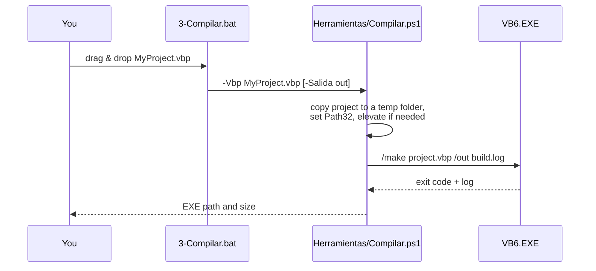
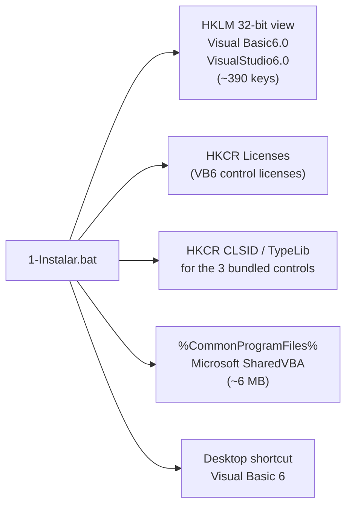

# VB6 Anywhere

**English** | [Espanol](README.md)

**The complete VB6 IDE (form designer, F5, breakpoints) and compiler, running from a folder. **No VB6 installation, no virtual machine.****

Tested on **Windows 10 and Windows 11 (x64)**, with no VB6 setup required — including a **virgin
Windows 11 Enterprise VM** where nothing VB6-related had ever been installed.

```text
1. Extract the folder anywhere
2. Right-click 1-Instalar.bat -> Run          (one time, needs admin)
3. Right-click 4-Abrir VB6.bat  -> Run        (or use the desktop shortcut)
```

> The `.bat` / `.ps1` files print their messages in Spanish. The code is commented
> in Spanish too. This README and everything in [`docs/`](docs/) is in English.

---

## What you get

| | |
|---|---|
| **IDE** | VB6 6.00.9782 (Service Pack 6) — form designer, toolbox, project explorer, properties, object browser and the **full debugger**: breakpoints (F9), F5, step into / step over, Immediate window, Watch, Call Stack |
| **Build from the IDE** | *File ▸ Make Project.exe* — the normal way, exactly as in 1998 |
| **Headless build** | `3-Compilar.bat` / `Herramientas\Compilar.ps1` — one command, no GUI: for CI pipelines, AI agents, or simply rebuilding a project without opening it |
| **Controls** | the 18 `.ocx` and 3 `.dll` that ship with VB6 Professional: `MSCOMCTL`, `MSCOMCT2`, `THREED32`, `COMCTL32`, `MSADODC`, `MSDATGRD`, `TABCTL32`, `COMDLG32` and the rest |
| **DAO 3.51** | the data-access library the default VB6 project references; registered only when the machine has none |
| **Registered, not just copied** | the VBA runtime is also registered where the IDE looks for it (`Shared Tools`), which is what makes it work on a clean machine |
| **Complete VS6 shared tree** | kept exactly as it was on the reference machine, on purpose — see [Why keep the whole tree?](#why-keep-the-whole-vs6-tree) |
| **No** | third-party controls, license keys that are not VB6's own, sample projects, or any customer data |

It does not install anything into `Program Files`. It lives in its own folder and writes only the
registry keys a VB6 installation would write anyway.

---

> It is called `1-Instalar.bat` (install) because it registers the runtime, the registry keys and the
> ActiveX controls. **VB6 itself already ships in the folder and is never installed.**

## Requirements

- Windows 10 or Windows 11, **64-bit**.
- Administrator rights **once**, for the install step (UAC with your own account is enough —
  you do not need the built-in `Administrator` account).
- ~130 MB of disk.

---

## Developing, debugging and building

**This is a complete IDE, not a compiler wrapper.** You can add forms and controls, edit code,
set breakpoints, run the project (F5), step through it, inspect variables, and build the final
`.exe` from *File ▸ Make Project.exe* — the same workflow as on a 1998 workstation. If your project
has working connection strings, F5 will reach your database exactly as it would from an installed
VB6.

Two ways to get an `.exe`, same compiler underneath:



| | Inside the IDE | Headless (`3-Compilar.bat`) |
|---|---|---|
| Best for | developing, debugging, designing forms | CI pipelines, AI agents, quick rebuilds |
| Breakpoints / watch / step | ✔ | — |
| Needs a desktop session | ✔ | only for the first install |
| Output | you choose in the dialog | folder + exit code + log |
| Safe to automate | no (it is a GUI) | **yes** — deterministic exit codes |

### Why the headless build exists

Somebody — or something — may need the EXE **without a human**:

- **CI pipelines**: check out, run `Compilar.ps1`, get exit code `0` and an artifact. No window
  focus, no clicking, no screen resolution to care about.
- **AI agents / scripted maintenance**: an agent can read the exit code and the log, retry, and
  report precisely which module failed — driving a 1998 GUI would be fragile automation.
- **Daily work**: rebuild in two seconds without opening the IDE at all.

```powershell
# the machine-readable contract
Herramientas\Compilar.ps1 -Vbp "C:\path\MyProject.vbp" -Salida "C:\path\out"
#   exit 0 -> C:\path\out\MyProject.exe
#   exit 2 -> compilation failed; the failing build.log lines are printed
```

It copies the project to `%TEMP%` first, so **your source tree is never modified**, and it injects
`Path32` into the `.vbp` copy if the project does not carry it.

---

## How it works

VB6 is a 32-bit application whose IDE resolves almost everything through the registry. Instead of
installing it, this package points those keys at its own folder and gives the IDE the one thing it
refuses to start without: the **shared VBA runtime**.



Three details make the difference between "it starts" and "it exits after the splash screen":

1. **The shared VBA runtime must exist at its standard location.** The VB6 IDE uses the VBA
   engine as its code editor. If `%CommonProgramFiles%\Microsoft Shared\VBA\VBA6\<lang>\VBE6INTL.DLL`
   is missing, the IDE opens its window and quits with *"Unexpected error; quitting"* — with **no
   exception raised at all**, which is why it looks like a crash but is not.
2. **The registry is not optional, and not just two values.** A real VB6 install writes ~470 keys
   under `Visual Basic\6.0` and `VisualStudio\6.0`. `Path`/`Path32` alone are not enough.
3. **The binaries must come from the same build.** Mixing `VB6.EXE` from one build with a
   `VB6IDE.DLL` from another produces the same silent exit.

The registry file shipped here uses a `__PKG__` placeholder instead of absolute paths, so the
package works from any folder (`D:\VB6-Anywhere`, `C:\Tools\VB6`, a USB stick...). `1-Instalar.bat`
substitutes the real path at install time.

### Install flow



### Compiling



---

## Repository layout

```text
.
├── 1-Instalar.bat            install (one time, needs admin)
├── 2-Verificar.bat           show OK/FAIL of every check
├── 3-Compilar.bat            compile a .vbp without opening the IDE
├── 4-Abrir VB6.bat           open the IDE (elevated)
├── 5-Diagnostico.bat         collect a read-only diagnostic report
├── 9-Desinstalar.bat         undo everything
├── Instalar.ps1              the installer itself
├── Desinstalar.ps1           the uninstaller
├── Herramientas/
│   ├── Abrir-VB6.ps1         IDE launcher (checks the VBA runtime first)
│   ├── Compilar.ps1          command-line compiler wrapper
│   ├── Registrar-Typelib.ps1 register a type library (used for DAO 3.51)
│   ├── Diagnostico.ps1       read-only report: system, languages, VBA runtime, registry
│   └── Reparar-IDE.ps1       clears inherited IDE state (machine that already had VB6)
├── 01_IDE/
│   ├── VB98/                 the IDE, compiler and wizards
│   └── Common/               Visual Studio 6 shared files (IDE98, ...)
├── 02_Componentes/
│   ├── VBA/                  shared VBA runtime required by the IDE
│   ├── Controles/            the 18 .ocx + 3 .dll that ship with VB6
│   └── Licencias/            registry + design-time licenses
├── docs/
│   ├── TESTING.md            every test performed, machine, date and result
│   ├── HOW-IT-WAS-MADE.md    the forensic work behind this package
│   └── VERIFIED.md           what has been tested, and how to re-test it
├── README.md                  Spanish version (the default one)
└── NOTICE.md                 legal notice
```

---

## What it writes on your system

Everything is reversible with `9-Desinstalar.bat`.



Nothing is written to `Program Files`, `System32`, `PATH`, or as a service. **If you move the
folder, run `1-Instalar.bat` again** — the registry points at the folder's absolute path.

---

## Troubleshooting

| Symptom | Cause | Fix |
|---|---|---|
| *"Unexpected error; quitting"* / *"Error inesperado. Se cerrará el programa"* right after the splash | The shared VBA runtime is missing | Run `1-Instalar.bat` |
| *"Error al intentar tener acceso al registro del sistema"* | VB6 wants to write to HKLM; you launched it without elevation | Use `4-Abrir VB6.bat` (it asks for UAC) |
| Asks for a license for some control | That control is **not** in this package | Install your own licensed copy, then re-run `1-Instalar.bat` |
| The IDE opens but the toolbox is empty | Controls not registered | Run `1-Instalar.bat`, then `2-Verificar.bat` |
| Worked before, stopped after moving the folder | Registry paths are absolute | Re-run `1-Instalar.bat` from the new location |
| *"Errores de carga ... Form1.frm"* when compiling | The `.frm` uses LF line endings; VB6 requires CRLF | Convert the file to CRLF |

`2-Verificar.bat` tells you exactly which check fails and which path it is using.

---

## Why keep the whole VS6 tree?

The package ships `01_IDE\Common` exactly as it existed on the reference machine — including
`Common\MSDev98` (Visual C++ 6) and `Common\Tools` (VS-Ent utilities, VCM, API Viewer). Strictly
speaking, compiling a VB6 project only needs `Common\IDE\IDE98`.

It is kept complete **on purpose**:

- **Plug and play is the whole point.** Deleting ~60 MB turns "double-click and it works" into
  "some feature silently fails and now you have to work out which DLL was in the folder you removed".
- **Parity with a real installation.** The tree matches what an installed VB6 looks like, so the
  behaviour — and therefore every existing Stack Overflow answer, forum post and Microsoft KB about
  VB6 — applies unchanged.
- **The extras are wired into the IDE.** The wizards, the API Viewer, the component browser and the
  packaging wizard reach into `Common`; a trimmed tree can leave dangling entries that surface much
  later, as an unrelated-looking error.

So: **no trimming in this repository.** If you want a slim build for a specific deployment, fork it
and test the exact features you need — the 126 MB here is the price of not having to debug
missing-component problems.

---

## Not included

- **FarPoint Spread, Crystal Reports, or any other third-party control** — they require their own
  licenses. If your project needs them, install your own licensed copy; the registry entries this
  package writes do not conflict with them.
- **The VB6 installer media** — you do not need it.
- **Any project, database, connection string or company configuration.**

---

## Verified on

See [`docs/VERIFIED.md`](docs/VERIFIED.md) for the exact test matrix (IDE start, project load,
compile, relocation) and how to reproduce it.

---

## How this was made

The short version: a licensed VB6 installation was extracted from a **Windows 7 (32-bit) virtual
machine**, its file set and registry were captured, and then the whole thing was made relocatable and
reproducible. The interesting part was finding out *why* a copied folder of VB6 files refuses to
start — it took a process dump, a Process Monitor trace and some decompilation.

Full story, with diagrams and evidence: [`docs/HOW-IT-WAS-MADE.md`](docs/HOW-IT-WAS-MADE.md).

---

## Documentation

| Document | What is in it |
|---|---|
| [Testing](docs/TESTING.md) | every test actually executed, with machine, date and result |
| [Architecture](docs/ARCHITECTURE.md) | how VB6 resolves its files, which registry keys actually matter, why the VBA runtime cannot live inside the folder |
| [How it was made](docs/HOW-IT-WAS-MADE.md) | extracting a licensed VB6 from a Windows 7 VM, and the forensics behind the silent exit |
| [Scripts](docs/SCRIPTS.md) | every script: parameters, steps, exit codes |
| [Troubleshooting](docs/TROUBLESHOOTING.md) | symptom → cause → fix, and how to collect evidence for an issue |
| [FAQ](docs/FAQ.md) | licensing, portability, CI, 32-bit, antivirus, third-party controls… |
| [Verified](docs/VERIFIED.md) | the test matrix, and how to reproduce it |
| [License](LICENSE) | MIT for the scripts, tooling and docs (not for the Microsoft binaries) |
| [Changelog](CHANGELOG.md) | what changed and why |

---

## Legal

Visual Basic 6.0 is a discontinued Microsoft product (support ended April 8, 2008). This
repository only repackages files from an existing VB6 installation so it can run portably.
**You must own a valid VB6 license to use it.** No third-party controls, third-party license
keys, customer data or company configuration are included.

Read [`NOTICE.md`](NOTICE.md) before using or redistributing. Not affiliated with or endorsed by
Microsoft. Microsoft, Visual Basic and Visual Studio are trademarks of Microsoft Corporation.


> If the IDE closes when you load a project, run `6-Reparar IDE.bat`.

## Search terms that lead here

If you got here looking for any of these, this is it:

*VB6 on Windows 10* · *VB6 on Windows 11* · *VB6 portable* · *VB6 without installing* ·
*VB6 without a virtual machine* · *modern VB6* · *run VB6 on 64-bit Windows* ·
*portable Visual Basic 6 IDE* · *compile VB6 from PowerShell or a pipeline* ·
*open an old .vbp on Windows 11*

This package is not a replacement for VB6: it repackages the IDE and compiler files so they
can run from a folder. You need a valid Visual Basic 6.0 licence.

> It is also in the **Start menu**: type `VB6` in the Windows search box and it comes up.
> A desktop shortcut is not returned by Start search; a Start menu entry is.
