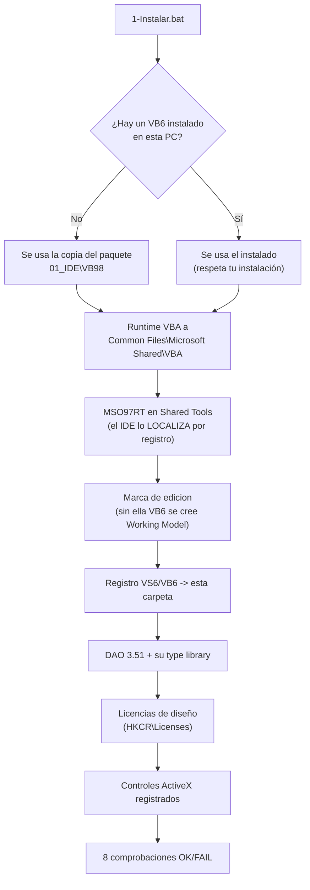

# VB6 Anywhere

**Español** | [English](README.en.md)

Visual Basic 6 funcionando **desde una carpeta** en Windows 10/11 de 64 bits:
sin instalar VB6, sin máquina virtual y sin montar nada a mano. Se descomprime,
se ejecutan los `.bat` y ya tienes el **IDE completo** (diseñador de formularios,
F5, puntos de interrupción, ventana de variables) y el **compilador**.

Sirve para cualquier `.vbp`, incluidos los proyectos heredados que dan guerra en
Windows moderno.

> **Estado:** probado en **Windows 10 22H2** y **Windows 11 Enterprise**, cada uno
> en una máquina virtual instalada desde cero, con este paquete y unos proyectos de
> ejemplo como único contenido de la máquina. Detalle de todas las pruebas en
> [docs/TESTING.md](docs/TESTING.md).

---

## Qué incluye

| Pieza | Detalle |
|---|---|
| **IDE** | `VB6.EXE` 6.00.9782 (Service Pack 6) con `VB6IDE.DLL` y `VBA6.DLL` de la misma build |
| **Compilador** | El mismo `VB6.EXE /make`: compila sin abrir el IDE |
| **Runtime VBA** | `MSO97RT.DLL`, `MRT7ESP.DLL` y `VBA6\3082\VBE6INTL.DLL`, copiados a `Common Files` |
| **DAO 3.51** | `DAO350.DLL` + registro de su type library (lo necesita el proyecto estándar) |
| **Controles de Microsoft** | 19 `.ocx` y 3 `.dll` de VB6 Professional: `MSCOMCTL`, `MSCOMCT2`, `THREED32`, `MSADODC`, `MSDATGRD`, `TABCTL32`, `COMDLG32`, `MSMASK32`, `MSFLXGRD`, `MSHFLXGD`, `MSCHRT20`, `MSCOMM32`, `MSINET`, `MSWINSCK`, `MCI32`, `RICHTX32`, `MSRDO20`, `MSSTDFMT`, `MSBIND` |
| **Árbol VS6** | `MSDev98`, `Tools`, `Common` completos: es lo que hace que un proyecto real abra sin quejarse |

No incluye proyectos: sirve para los tuyos.

## Requisitos

- Windows 10 u 11 de **64 bits**.
- Permisos de administrador **solo** durante `1-Instalar.bat` (te eleva tu propio
  usuario; no hace falta la cuenta Administrador).
- Una licencia válida de Visual Basic 6.0. Ver [NOTICE.md](NOTICE.md).

---

## Instalación en 3 pasos

```
1. Descomprime la carpeta donde quieras (ej. D:\VB6-Anywhere)
2. Doble clic en  1-Instalar.bat     y acepta el UAC
3. Doble clic en  4-Abrir VB6.bat    o usa el acceso "Visual Basic 6" del escritorio
```

> También aparece en el **menú Inicio**: escribe `VB6` en el buscador de Windows y lo
> tienes ahí. El acceso del escritorio no lo encuentra la búsqueda; el del menú Inicio sí.

Comprobar en cualquier momento: `2-Verificar.bat` → **8 comprobaciones**, todas `OK`.
Deshacer: `9-Desinstalar.bat`.

> Se llama `1-Instalar.bat` porque **registra** el runtime, las claves y los controles
> ActiveX. **VB6 en sí ya viene en la carpeta y no se instala nunca.**

La carpeta **no es de usar y tirar**: puedes moverla, pero si la mueves hay que
repetir `1-Instalar.bat`, porque el registro apunta a esa ruta.

## Depurar y compilar desde el IDE

Esto es un VB6 normal, así que todo lo de siempre funciona:

- `F5` ejecuta, `F8` paso a paso, puntos de interrupción, ventana de variables,
  `Ctrl+G` para la ventana de inmediato.
- `Archivo > Generar Proyecto.exe` produce el ejecutable.

## Compilar sin abrir el IDE

`3-Compilar.bat` compila en modo desatendido y **devuelve códigos de salida útiles**,
así que sirve para un pipeline o para que lo llame un agente de IA:

```
3-Compilar.bat  D:\ruta\MiProyecto.vbp  D:\salida
    exit 0 -> D:\salida\MiProyecto.exe generado
    exit 2 -> fallo de compilacion; se imprimen las lineas del build.log
```

## Cómo funciona



El orden importa: sin el runtime VBA el IDE abre y **se cierra solo**; sin la marca
de edición se cree "Working Model" y no compila; y sin `Shared Tools\mso97rt` el IDE
abre el splash y se cierra sin decir nada (ver más abajo).

## Scripts

| Script | Para qué |
|---|---|
| `1-Instalar.bat` | Instalación completa (6 pasos + verificación) |
| `2-Verificar.bat` | Repite solo la verificación, sin tocar nada |
| `3-Compilar.bat` | Compila un `.vbp` sin abrir el IDE, con códigos de salida |
| `4-Abrir VB6.bat` | Abre el IDE con UAC |
| `5-Diagnostico.bat` | Genera `diagnostico.txt` para reportar un fallo (solo lectura) |
| `6-Reparar IDE.bat` | Repara un IDE que se cierra al cargar un proyecto |
| `9-Desinstalar.bat` | Retira registro, controles, runtime y acceso directo |

## Las 8 comprobaciones

| Comprobación | Qué detecta |
|---|---|
| `IDE VB6.EXE` | Falta el ejecutable o el paquete está incompleto |
| `Path del IDE` | El registro apunta a otra carpeta: hay que reinstalar |
| `Marca de edición` | VB6 se cree "Working Model" y no compila |
| `MSCOMCTL registrado` | Los formularios no cargarían |
| `Runtime VBA (IDE)` | El IDE se cierra al arrancar |
| `Registro VS6/VB6` | El IDE pierde funcionalidad |
| `DAO 3.51 (IDE)` | El proyecto estándar pide `DAO350.DLL` |
| `MSO97RT registrado` | El IDE abre el splash y se cierra |

## Problemas típicos

**El IDE abre y se cierra al instante.** `2-Verificar.bat`: casi siempre falta el
runtime VBA o la clave `Shared Tools\mso97rt`. `1-Instalar.bat` lo deja en su sitio.

**Pide `DAO350.DLL`.** Falta el registro de la type library de DAO. También lo
resuelve `1-Instalar.bat` (paso 5).

**Abre, carga el proyecto y se cierra a los dos segundos.** Solo pasa en PCs que
**ya tuvieron VB6** (instalado o una copia portable anterior): el IDE hereda estado
del usuario y una caché de componentes con rutas que ya no existen. `6-Reparar IDE.bat`
hace copia de seguridad de las dos claves y las limpia.

**Avisa de controles que no puede cargar.** Son los de terceros (`Encuentra.ocx`,
`Crystl32.ocx`, `SPR32X60.ocx`, `SS32X25.ocx`…) que **no** se distribuyen aquí. Ver
"Lo que no se incluye".

Más casos en [docs/TROUBLESHOOTING.md](docs/TROUBLESHOOTING.md).

## Lo que no se incluye

- **Controles de terceros**: FarPoint Spread, Crystal Reports y controles propios de
  cada empresa, con sus licencias y ficheros `license.dat`.
- **Proyectos, bases de datos, credenciales o configuración** de ninguna empresa.
- **El instalador de VB6** (`03_Instaladores/` está en `.gitignore`).

Si tu proyecto usa esos controles, instálalos tú: este paquete solo cubre lo que
Microsoft publicó con VB6.

## Documentación

La documentación técnica está en inglés:

| Documento | Contenido |
|---|---|
| [docs/TESTING.md](docs/TESTING.md) | Todas las pruebas hechas, con máquina, fecha y resultado |
| [docs/ARCHITECTURE.md](docs/ARCHITECTURE.md) | Qué hace el instalador y por qué, pieza por pieza |
| [docs/HOW-IT-WAS-MADE.md](docs/HOW-IT-WAS-MADE.md) | Cómo se extrajo todo de una VM con Windows 7 |
| [docs/SCRIPTS.md](docs/SCRIPTS.md) | Referencia de cada script y cada comprobación |
| [docs/TROUBLESHOOTING.md](docs/TROUBLESHOOTING.md) | Síntomas, causa y arreglo |
| [docs/VERIFIED.md](docs/VERIFIED.md) | Matriz de sistemas y builds verificados |
| [docs/FAQ.md](docs/FAQ.md) | Preguntas frecuentes |
| [CHANGELOG.md](CHANGELOG.md) | Qué cambió y por qué |
| [NOTICE.md](NOTICE.md) | Aviso legal, en español e inglés |

## Aviso legal

Visual Basic 6.0 es propiedad de **Microsoft Corporation** y está descatalogado
(fin de soporte: 8 de abril de 2008). Este repositorio **no concede ninguna licencia
de VB6**: úsalo solo si ya dispones de una licencia válida. No está afiliado,
patrocinado ni respaldado por Microsoft.

El código de los scripts, la documentación y las herramientas de este repositorio
está bajo licencia [MIT](LICENSE). Esa licencia **no cubre** los binarios de
Microsoft que el paquete reempaqueta.

Si eres titular de derechos y quieres que se retire algún contenido, abre un *issue*.

## Búsquedas que llevan aquí

Si llegaste buscando alguna de estas cosas, es esto:

*VB6 en Windows 10* · *VB6 en Windows 11* · *VB6 portable* · *VB6 sin instalar* ·
*VB6 sin máquina virtual* · *VB6 moderno* · *usar VB6 en Windows de 64 bits* ·
*IDE de Visual Basic 6 portátil* · *compilar VB6 desde PowerShell o un pipeline* ·
*abrir un .vbp viejo en Windows 11*

Este paquete no sustituye a VB6: reempaqueta los ficheros del IDE y del compilador para
que se ejecuten desde una carpeta. Necesitas una licencia válida de Visual Basic 6.0.
