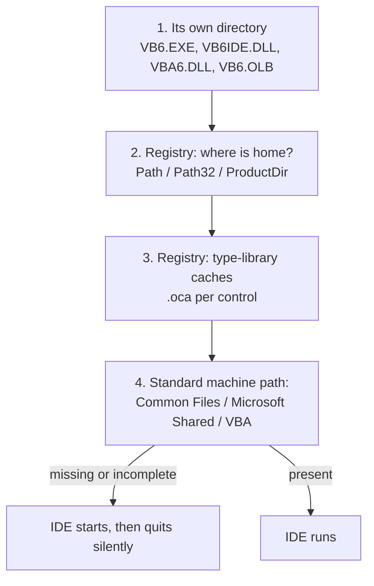
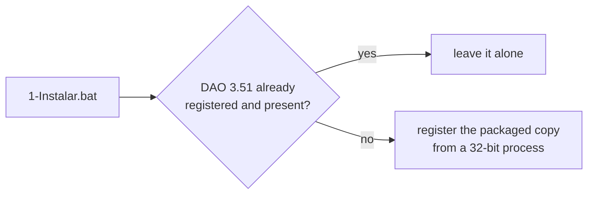
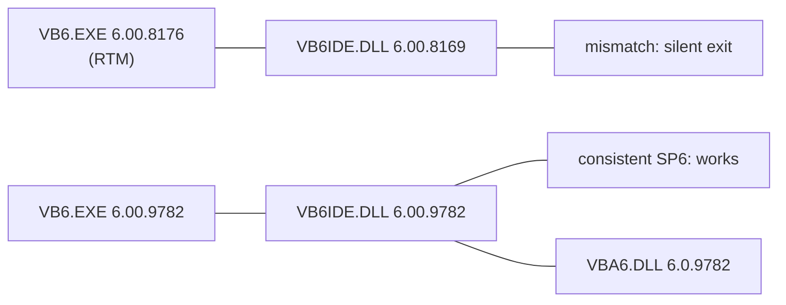
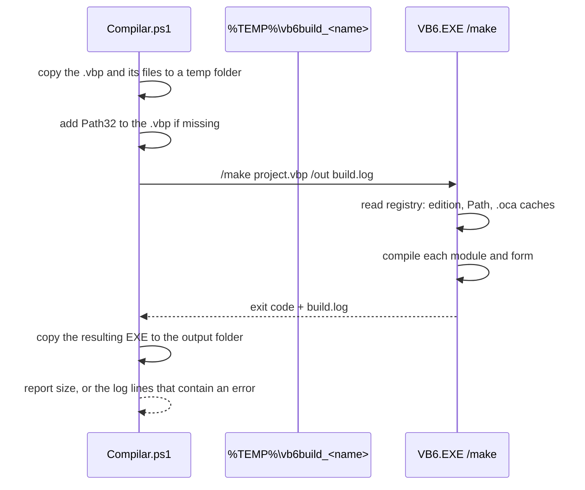

# Architecture

How the pieces fit together, and **which registry keys actually matter**. This is the reference
you want when something breaks and `2-Verificar.bat` is not enough.

---

## The big picture

VB6 is a 32-bit application from 1998. It has no configuration file: everything it needs to know
about itself comes from the registry, and everything it needs to *load* comes from its own folder
plus two machine-wide locations.



Steps 1–3 are satisfied by files inside the folder plus registry entries the installer writes.
Step 4 is the only one that **cannot** stay inside the folder — see below.

---

## Why the shared VBA runtime is the turning point

The VB6 IDE is itself a VBA host. Its code editor, the object browser and the "Add-Ins" machinery
are the VBA6 engine. When the IDE starts it tries to load its localisation resources from a **fixed
machine path**, not a relative one:

```text
%CommonProgramFiles%\Microsoft Shared\VBA\
├── MSO97RT.DLL              Office/VBA forms runtime
├── MRT7<lang>.DLL           MUI resources (MRT7ESP.DLL for Spanish, MRT7ENU.DLL for English)
└── VBA6\
    ├── VBE6EXT.OLB          VBA extensibility type library
    └── 3082\                (or 1033, 0407... = the OS UI language)
        └── VBE6INTL.DLL     <-- the file whose absence kills the IDE
```

If that directory is incomplete, VB6 shows its splash screen, creates its main window, and then
**exits with status 0** after a generic *"Unexpected error; quitting"* message. No exception is
raised, so nothing appears in the event log and no crash dump is produced.

Putting `MSO97RT.DLL` next to `VB6.EXE` gets you one step further (the IDE creates its internal
`MsoStdCompMgr` window and then dies) but is **not** enough.

`1-Instalar.bat` copies this folder (~6 MB) to both `Program Files\Common Files` and
`Program Files (x86)\Common Files` when present, and `9-Desinstalar.bat` removes it only if it is
byte-identical to what was installed.

`Herramientas\Abrir-VB6.ps1` checks for `VBE6INTL.DLL` **before** launching the IDE, so the user
gets an actionable message instead of a silent exit.

---

## Other things the IDE loads at start-up

The VBA runtime is not the only dependency a *clean* machine is missing. VB6 resolves the references
of its default project while starting, and the default project references **DAO 3.51**:

| What | Where it must be | How it is located |
|---|---|---|
| `MSO97RT.DLL` | it is **located** through `HKCR`/HKLM: `HKLM\SOFTWARE\WOW6432Node\Microsoft\Shared Tools\mso97rt` -> `Path` (plus `SharedFilesDir` on the parent key) | registry, not a fixed folder |
| `DAO350.DLL` | anywhere; its type library is registered with an absolute path | registry: `HKCR\TypeLib\{00025E01-…}\`**`4.0`**`\0\win32` (the DAO "3.51" library is type-library version **4.0**) |

If that registration is missing, the IDE shows *"No se puede encontrar el archivo 'DAO350.DLL'"* right
after the splash screen. This package ships the DLL next to `VB6.EXE` and registers it **only when the
machine has no working DAO registration of its own**, so an Office or VB6 installation keeps using
its copy.



`regsvr32` cannot do this: `dao350.dll` exports no `DllRegisterServer`. The registration is done with
`LoadTypeLibEx(..., REGKIND_REGISTER)` from `Herramientas\Registrar-Typelib.ps1`, launched with the
**32-bit** PowerShell, because that is the registry view VB6 reads.

---

## Registry keys that matter

All of them live in the **32-bit view** of the registry. On 64-bit Windows that means
`HKLM\SOFTWARE\WOW6432Node\...`; importing them into the 64-bit view has no effect at all
(VB6 will not see them).

### Where VB6 lives

| Key | Value | Purpose |
|---|---|---|
| `...\Microsoft\Visual Basic\6.0` | `Path`, `Path32` | IDE home directory |
| `...\Microsoft\VisualStudio\6.0` | `InstallDir` | VS6 shared tree, i.e. `...\Common\IDE\IDE98` |
| `...\VisualStudio\6.0\Setup\Microsoft Visual Basic` | `ProductDir` | installation directory |
| `...\VisualStudio\6.0\Setup\Microsoft Visual Basic\SetupWizard-<lcid>-<edition>` | `InstallDir` | as written by the original setup |

### Which edition it thinks it is

| Key | Value | Purpose |
|---|---|---|
| `...\Microsoft\IE4\DependentComponents` | `VB98 = "Microsoft Visual Basic 6.0 Enterprise Edition"` | without it the IDE believes it is the *Working Model* edition and refuses to compile |

This single value is the difference between a greyed-out *File ▸ Make* and a working compiler.

### Type-library caches (`.oca`)

| Key | Value | Purpose |
|---|---|---|
| `...\Visual Basic\6.0\{TYPELIB-GUID}#{version}` | full path to a `.oca` file | tells VB6 which build of a control a project refers to, without instantiating it |

A project that asks for `Encuentra 38.4` or `Spread 6.0` is resolved from here. If the entry is
missing, VB6 falls back to loading the control — which is where licensing dialogs appear.

The installer writes entries for the three bundled controls and, if the `.oca` files exist in the
package, they are used; otherwise VB6 regenerates them on first use, next to the OCX.

### Design-time licenses

| Key | Purpose |
|---|---|
| `HKCR\Licenses\{GUID}` | the encrypted key that lets a *licensed* control be used in the designer |

See [`../NOTICE.md`](../NOTICE.md) for what is and is not shipped.

### COM registration

| Key | Purpose |
|---|---|
| `HKCR\CLSID\{...}\InprocServer32` | absolute path to the `.ocx` / `.dll` |
| `HKCR\TypeLib\{...}\<ver>\<lcid>\win32` | same, for type libraries |

`regsvr32` writes both. Because they store **absolute** paths, moving the folder requires
re-registering — hence "re-run `1-Instalar.bat` after moving".

---

## Build consistency

VB6 binaries must come from the same service pack. Mixing them produces exactly the same silent
exit as a missing VBA runtime, which is why it is worth checking first:



This package ships the consistent SP6 set (`6.00.9782`). Check it with:

```powershell
(Get-Item .\01_IDE\VB98\VB6.EXE).VersionInfo.FileVersion
(Get-Item .\01_IDE\VB98\VB6IDE.DLL).VersionInfo.FileVersion
(Get-Item .\01_IDE\VB98\VBA6.DLL).VersionInfo.FileVersion
```

All three should report `6.00.9782` / `6.0.9782`.

---

## What happens on a compile (`/make`)



Compiling writes to `HKLM` (window/state and cache bookkeeping), so the wrapper elevates **only when
needed**. Once the package is installed, a plain `/make` from a normal shell works — verified.

---

## Relocation


The shipped `vb6_registro.reg` contains no absolute path at all: every path is the literal token
`__PKG__`, substituted at install time (with backslashes doubled, as `.reg` syntax requires).

---

## Deliberate design decisions

These are intentional. Please do not "fix" them without reading why.

| Decision | Why |
|---|---|
| **The whole `Common` tree is shipped** (`IDE98`, `MSDev98`, `Tools`, `Graphics`) | Plug and play. Compiling only needs `IDE98`, but the rest is wired into wizards and component tools; trimming ~60 MB buys a class of "silently missing component" bugs that are extremely hard to trace. Parity with a real installation also means every existing VB6 answer online applies unchanged. |
| **The package always uses its own `01_IDE\VB98`** | A portable package must not adopt a VB6 found in the registry: it would end up configuring *that* folder instead of itself. |
| **`__PKG__` instead of hardcoded paths** | Relocatable by design; the installer resolves it to wherever the folder is. |
| **The VBA runtime is copied outside the folder** | VB6 loads it from a fixed machine path. There is no in-folder alternative — this is the one exception to "everything stays in the folder". |
| **Scripts speak Spanish, documentation speaks English** | The original team's language versus the audience of a public repository. |
| **Elevation only for the install and the IDE start** | VB6 writes `HKLM` in both cases. Nothing runs as a service, a driver, or at boot. |
| **No third-party controls or licences** | See [`../NOTICE.md`](../NOTICE.md). |
