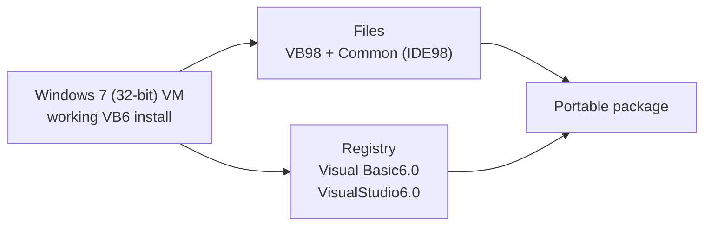
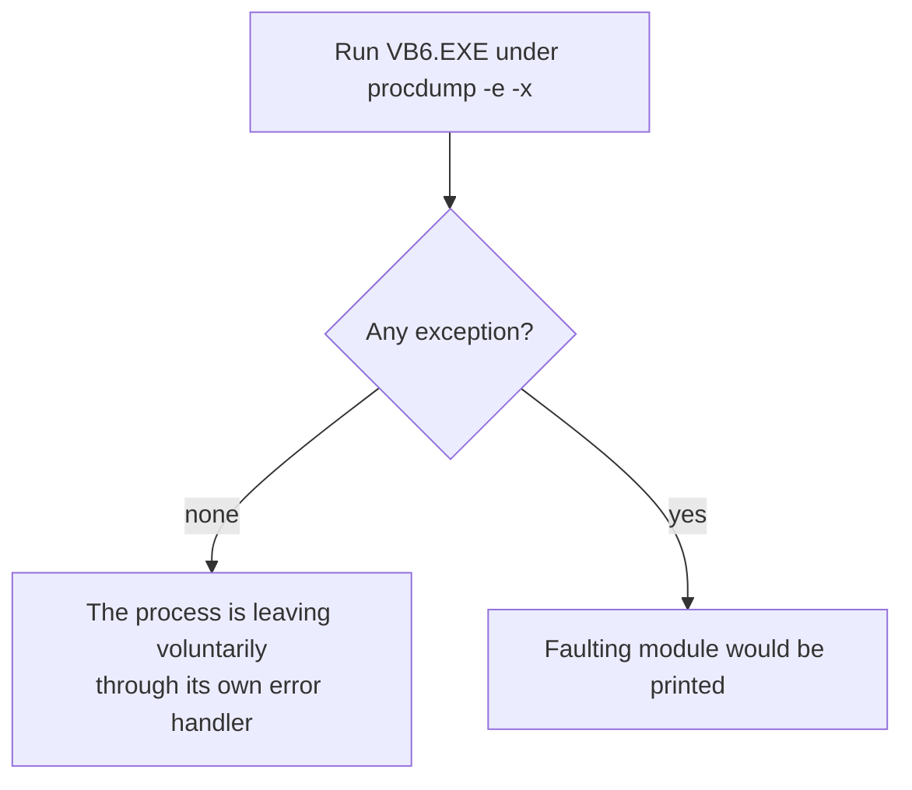
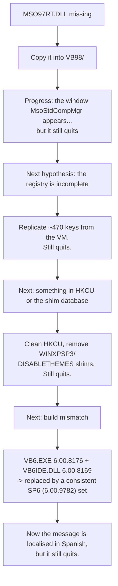
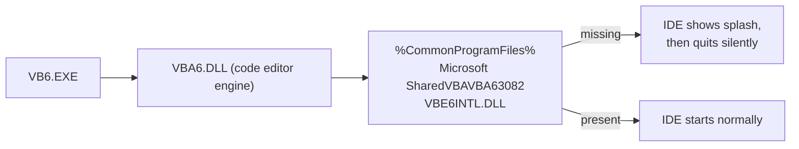

# How this package was made

> A VB6 folder copied from an old machine does **not** simply run. This document explains what
> was extracted, why the first attempts failed, and how the failure was diagnosed — including the
> dead end that cost the most time, so nobody has to repeat it.

---

## 1. The starting point

The reference machine was a **Windows 7 (32-bit) virtual machine** with a working, licensed VB6
installation — the kind of throwaway VM these projects were originally developed on. Two things were
taken from it:



| What | How | Size |
|---|---|---|
| `VB98` | copied from the VM's install folder | ~1 000 files |
| `Common` | Visual Studio 6 shared tree (`IDE98` holds `MSENV.DLL`, `VSEXT.OLB`, ...) | ~1 600 files |
| Registry | `reg export` on the VM (run as SYSTEM through a remote service, because `reg export` needs a writable target) | ~470 keys |

Where each piece lived on the reference machine (Windows 7 has no `Program Files (x86)`) and where it
ends up in this package:

| On the Windows 7 VM | In this package |
|---|---|
| `C:\Program Files\Microsoft Visual Studio\VB98` | `01_IDE\VB98` |
| `C:\Program Files\Microsoft Visual Studio\Common` | `01_IDE\Common` (holds `IDE98`, `MSENV.DLL`, `VSEXT.OLB`…) |
| `C:\Program Files\Common Files\Microsoft Shared\VBA` | `02_Componentes\VBA`, copied back to `Common Files` at install time |
| `HKLM\SOFTWARE\Microsoft\Visual Basic\6.0` | same key, **32-bit view**, i.e. under `WOW6432Node` |
| `HKLM\SOFTWARE\Microsoft\VisualStudio\6.0` | same key, **32-bit view** |

Because the VM was **32-bit**, its `HKLM\SOFTWARE\Microsoft\...` corresponds to
`HKLM\SOFTWARE\WOW6432Node\Microsoft\...` on a 64-bit host. Every import in this package therefore
uses `reg.exe ... /reg:32`; importing into the 64-bit view silently produces a VB6 that cannot see
its own settings.

---

## 2. First attempt: copy the files, write two registry values

The obvious approach — put `VB98` in a folder, set `Path` and `Path32` — starts the IDE. The
splash screen appears, the main window is created... and then the process **exits on its own**
within a second, showing:

```
Unexpected error; quitting
```

No crash dialog, no error code, exit status 0.

---

## 3. Diagnosing a program that decides to quit

### 3.1 It is not a crash



`procdump -e -x` recorded **zero** dumps. That single fact redefined the problem: nothing was
crashing. The IDE was *deciding* to quit.

### 3.2 Where does the message come from?

The process was still alive with the message box on screen, so a full memory dump was taken
(`procdump -ma <pid>`) and parsed with a small Python minidump reader:

- `MINIDUMP_MODULE_LIST` → 62 modules, in load order.
- The UTF-16 string `"Unexpected error"` exists **only in `VB6IDE.DLL`** (as a resource), so the
  text is a string resource, not a literal.
- `MINIDUMP_THREAD_LIST` → the UI thread was parked in `win32u.dll` (i.e. inside `MessageBox`).
  Walking that thread's stack mapped the return addresses back to `VB6.EXE`.

One of those addresses was resolved with **REA / Ghidra**:

```text
FUN_0044a47e  ->  VB error formatter
    FormatMessageA(...)
    wsprintfA("&H%08lX (%ld)", ...)
    FUN_004a2259(...)      // sets Err.Description
```

So the frame was the **generic VB error formatter**. The IDE had raised a runtime error with no
specific message and reported the fallback text. Useful, but it did not say *what* failed.

### 3.3 Ask the operating system

Process Monitor was pointed at `VB6.EXE` for the whole startup. The last interesting operation
before the process went quiet was:

```text
CreateFile  D:\...\MRT7ENU.DLL   NAME NOT FOUND
CreateFile  C:\Program Files\...\MRT7ENU.DLL  NAME NOT FOUND
... (56 directories, i.e. a full PATH scan)
```

A DLL searched across every `PATH` entry is a **failed `LoadLibrary`**. The name that mattered,
earlier in the same window, was:

```text
CreateFile  ...\MSO97RT.DLL   NAME NOT FOUND   (x56)
```

`MSO97RT.DLL` is the Office/VBA forms runtime. That was the first real lead.

---

## 4. The two dead ends worth recording



Four hypotheses, all *plausible*, all wrong on their own:

| Hypothesis | Test | Verdict |
|---|---|---|
| `VB6TMPL.TLB` is missing (a widely repeated fix) | searched the machine and the media | the file does not exist even on a working install → **not it** |
| Corrupt `HKCU` state | deleted `HKCU\Software\Microsoft\Visual Basic\6.0` | **not it** |
| Compatibility shims | `WINXPSP3`, `WIN7RTM`, `WIN8RTM`, `DISABLETHEMES` | **not it** |
| Mixed builds | compared hashes of `VB6.EXE` / `VB6IDE.DLL` / `VBA6.DLL` | a real problem, **but not the blocker** |

---

## 5. The actual fix

The turning point was installing VB6 **for real** on the test host for a few minutes and diffing
what the installer did that the package did not. The answer was a directory nobody had looked at:

```text
C:\Program Files (x86)\Common Files\Microsoft Shared\VBA\
├── MSO97RT.DLL
├── MRT7ESP.DLL
└── VBA6\
    └── 3082\
        └── VBE6INTL.DLL      <- the VBA IDE localisation resources
```

The VB6 **IDE uses the VBA engine as its code editor**. It looks for that engine under
`%CommonProgramFiles%\Microsoft Shared\VBA` — an absolute, machine-wide location, not a relative
one. With the folder present, the IDE started completely: designer, toolbox, project explorer,
menu bar, no warnings at all.

Copying the same DLLs next to `VB6.EXE` was **not** enough. It has to be that path.



This is the one thing a fully "portable" VB6 cannot keep inside its own folder. The installer
copies ~6 MB there, and `9-Desinstalar.bat` removes it again.

---

## 6. Making it relocatable and reproducible

With the IDE running, the remaining work was to turn a machine-specific snapshot into something
that installs from any folder:

1. **`__PKG__` placeholder.** The exported `.reg` contained `C:\Program Files\Microsoft Visual
   Studio\...` everywhere. It was rewritten to `__PKG__`, and `1-Instalar.bat` substitutes the real
   folder (with `\` doubled, as `.reg` syntax requires) before importing.
2. **Trimmed registry.** The VM export carried Visual C++, FoxPro and InterDev setup keys, Visual
   Component Manager / Repository add-ins (which pop up modal dialogs), `Analyzer`, `WebClass`, and
   ~70 type-library cache entries pointing at controls that are not shipped. All removed: 470 → 390 keys.
3. **Cache entries rewritten.** The `.oca` caches for the bundled controls are written explicitly
   by the installer, so they point inside the package instead of at the VM's install folder.
4. **Build consistency.** The IDE binaries were normalised to a single SP6 set (6.00.9782) instead
   of the mixture found on the VM.
5. **Tolerant file copy.** Copying the VBA runtime fails with `ERROR_USER_MAPPED_FILE` while the
   IDE is running, which used to abort the whole install. It now compares hashes, skips what is
   already identical, and never aborts on a locked file.

---

## 7. Turning it into a public package

For this repository everything tied to a specific company was removed:

- third-party controls (`FarPoint Spread`, `Crystal Reports`, a local `Encuentra` control) and the
  **patched** Spread 2.5 binary;
- the Faraday `license.dat` file those controls use for design-time licensing;
- 915 `.oca` type-library caches generated by the company's own controls;
- leftover project files, source-control bindings and a Visual SourceSafe database;
- the VB6 installer media (not needed anymore).

What remains is VB6 itself, its four Microsoft controls, and the minimum registry needed to run.
See [`../NOTICE.md`](../NOTICE.md).

---

## 8. If you want to reproduce the extraction

Roughly, on any machine with a working VB6 install:

```powershell
# 1. files
robocopy "<VB6 install>\VB98"  ".\01_IDE\VB98"  /E
robocopy "<VS6>\Common"        ".\01_IDE\Common" /E

# 2. registry (32-bit view!)
reg export "HKLM\SOFTWARE\Microsoft\Visual Basic\6.0" vb6.reg
reg export "HKLM\SOFTWARE\Microsoft\VisualStudio\6.0" vs6.reg

# 3. the piece that is easy to miss
robocopy "%CommonProgramFiles%\Microsoft Shared\VBA" ".\02_Componentes\VBA" /E

# 4. rewrite absolute paths to __PKG__ and import with: reg import vb6.reg /reg:32
```

Then compare with what this package does in `Instalar.ps1` — step by step, with verification.
