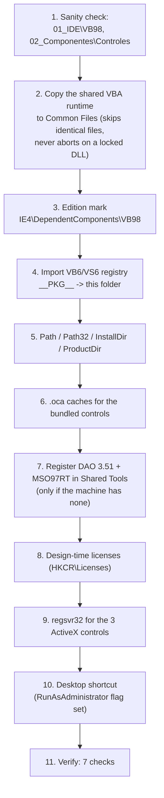

# Script reference

Everything is PowerShell 5.1 (the version built into Windows 10/11). The `.bat` files are thin
wrappers so you can double-click them; they print in Spanish.

| File | Elevates | Purpose |
|---|---|---|
| `1-Instalar.bat` → `Instalar.ps1` | yes | install / re-install the package |
| `2-Verificar.bat` → `Instalar.ps1 -SoloVerificar` | no | check everything, change nothing |
| `3-Compilar.bat` → `Herramientas\Compilar.ps1` | only if needed | compile a `.vbp` |
| `4-Abrir VB6.bat` → `Herramientas\Abrir-VB6.ps1` | yes | open the IDE |
| `5-Diagnostico.bat` → `Herramientas\Diagnostico.ps1` | no | write `diagnostico.txt`: system, languages, VBA runtime, registry, versions |
| `9-Desinstalar.bat` → `Desinstalar.ps1` | yes | undo the install |
| `Herramientas\Registrar-Typelib.ps1` | only as called by the installer | register a type library from a DLL that cannot self-register (DAO 3.51) |

---

## `1-Instalar.bat`

```bat
Instalar.ps1 [-SinAccesos] [-SoloVerificar] [-NoPause]
```

| Parameter | Effect |
|---|---|
| `-SoloVerificar` | runs all checks and prints OK/FAIL; writes nothing, no elevation needed |
| `-SinAccesos` | skips creating the desktop shortcut |
| `-NoPause` | does not wait for a key press at the end (useful for automation) |

Exit codes: `0` success · `1` the package is incomplete (a required folder is missing).

What it does, in order:



These are the 8 checks `2-Verificar.bat` prints:

| Check | Fails when |
|---|---|
| `IDE VB6.EXE` | `01_IDE\VB98\VB6.EXE` is missing |
| `Path del IDE` | `Path` does not point at this folder (folder was moved) |
| `Marca de edicion` | the edition mark is missing → the IDE cannot compile |
| `MSCOMCTL registrado` | the ActiveX controls are not registered |
| `Runtime VBA (IDE)` | `VBE6INTL.DLL` is not under `Common Files` → the IDE will exit silently |
| `Registro VS6/VB6` | the registry import did not happen |
| `DAO 3.51 (IDE)` | DAO is not registered, so the IDE stops with the DAO350.DLL message |
| `MSO97RT registrado` | `Shared Tools\mso97rt\Path` is missing, so the IDE loads its splash and closes |

---

## `2-Verificar.bat`

Runs `Instalar.ps1 -SoloVerificar`. Safe to run at any time, including while the IDE is open:
it only reads the registry and the filesystem. Use it first whenever something looks wrong —
it tells you which check fails **and which path it is using**.

---

## `3-Compilar.bat` / `Herramientas\Compilar.ps1`

```powershell
Herramientas\Compilar.ps1 -Vbp <path-to-.vbp> [-Salida <folder>] [-TimeoutSegundos 300] [-Elevado]
```

| Parameter | Default | Meaning |
|---|---|---|
| `-Vbp` | *(required)* | project to compile |
| `-Salida` | the `.vbp` folder | where the `.exe` is left |
| `-TimeoutSegundos` | `300` | kill the compiler if it hangs |
| `-Elevado` | off | internal: marks the already-elevated re-entry |

Exit codes: `0` the EXE was produced · `2` compilation failed (the relevant `build.log` lines are printed).

Notes:

- The project is copied to `%TEMP%\vb6build_<name>` first, so **your source tree is not touched**
  (VB6 rewrites `.vbp`/`.vbw` on build).
- If the `.vbp` has no `Path32`, the wrapper injects it — that key is what VB6 uses to find its
  own folder in the 32-bit view.
- Elevation happens only if the package has not been installed yet in this session.

Drag & drop also works: drop a `.vbp` on `3-Compilar.bat`.

### Why a headless compiler exists

Because some consumers have no hands. A CI pipeline or an AI agent needs a **deterministic exit code
and an artifact**, not a window it has to click. It is the same compiler (`VB6.EXE /make`), driven
without the IDE:

| Use case | Why this and not the IDE |
|---|---|
| **CI pipeline** | checkout → compile → publish the EXE as an artifact; no desktop session, no focus, no resolution |
| **AI agent / scripted maintenance** | read the exit code and the log, retry, report exactly which module failed |
| **Everyday rebuild** | two seconds, without opening the project |

The IDE is still the tool for *developing*: designer, F5, breakpoints, watch, step-into, and
*File ▸ Make Project.exe* for a build you drive yourself.

---

## `4-Abrir VB6.bat` / `Herramientas\Abrir-VB6.ps1`

No parameters. It:

1. checks that the shared VBA runtime is present — if not, it tells you to run `1-Instalar.bat`
   instead of letting the IDE die silently;
2. launches `VB6.EXE` **elevated** (VB6 writes to `HKLM` at start-up; without elevation you get
   *"Error al intentar tener acceso al registro del sistema"*).

You can also pass a project to open. From a shell:

```powershell
Start-Process .\01_IDE\VB98\VB6.EXE -ArgumentList '"C:\path\MyProject.vbp"' -Verb RunAs
```

---

## `5-Diagnostico.bat` / `Herramientas\Diagnostico.ps1`

**Read-only.** It changes nothing: it writes a single file, `diagnostico.txt`, inside the package.

```bat
5-Diagnostico.bat
```

What it records:

- Windows edition, build and architecture;
- installed UI language, system locale, user language list and any UI override;
- the three core binaries with version and SHA-256 (`VB6.EXE`, `VB6IDE.DLL`, `VBA6.DLL`), plus `DAO350.DLL`;
- the packaged VBA runtime and the controls;
- **the shared VBA runtime in `Common Files`**, every file, and which language folders under
  `VBA6` contain `VBE6INTL.DLL` — the most common reason for the silent exit;
- registry: `Path`, `Path32`, `InstallDir`, `ProductDir`, the edition mark, and DAO's type library;
- other VB6/VBA installations on the machine (Office, `msvbvm60.dll`, VBA7…);
- if a `VB6.EXE` is running, its loaded VBA-related modules.

Attach that file when reporting a problem: it answers most of the questions in one go.

---

## `9-Desinstalar.bat` / `Desinstalar.ps1`

```bat
Desinstalar.ps1 [-NoPause]
```

Removes, in this order:

1. the COM registration of the three bundled controls (`regsvr32 /u`);
2. the `.oca` cache entries it wrote;
3. the shared VBA runtime — **only if it is byte-identical to what was installed**
   (a pre-existing VBA folder belonging to another product is left alone);
4. the VB6 / VS6 registry keys;
5. the desktop shortcut.

It does **not** delete the package folder or `HKCR\Licenses` (both are inert without the rest).


## `6-Reparar IDE.bat`

Use it when the IDE opens but **closes as soon as you load a project**. That happens on a PC that
already had VB6 (a real installation or an older portable copy): the IDE inherits per-user state and
a component cache pointing at folders that no longer exist, and the first project that needs those
components takes the IDE down.

It is the only script here that **deletes** state, and it always backs it up first:

1. Exports and removes `HKCU\Software\Microsoft\Visual Basic\6.0` (window layout, toolbox, recent
   projects). The IDE rebuilds it on the next start.
2. Removes the component-cache entries under `HKLM\...\Visual Basic\6.0` whose `.oca` file is gone,
   or that point at a different portable tree.
3. Re-runs the installer verification so you can see the result.

The `.reg` backups are written to `%TEMP%` and their paths are printed. Nothing else is touched.

## Shortcuts

`1-Instalar.bat` leaves **four** shortcuts, and only the Start menu ones are reachable from the
Windows search box:

| Where | Name | Opens |
|---|---|---|
| Desktop | `Visual Basic 6.0 Portable` | the IDE (asks for admin, same as `4-Abrir VB6.bat`) |
| Start menu \ VB6 Anywhere | `Visual Basic 6.0 Portable` | the IDE (asks for admin) |
| Start menu \ VB6 Anywhere | `VB6` | the same IDE, under an alias so searching `vb6` finds it |
| Start menu \ VB6 Anywhere | `VB6 Anywhere (carpeta)` | the package folder in Explorer |
| Start menu \ VB6 Anywhere | `Desinstalar VB6 Anywhere` | `9-Desinstalar.bat` |

The Start menu group lives in the **per-user** profile
(`%APPDATA%\Microsoft\Windows\Start Menu\Programs\VB6 Anywhere`), so no elevation is needed to
create it and it disappears with `9-Desinstalar.bat`, which removes the whole group.

Why both: Windows search indexes the Start menu, **not** the desktop. A desktop-only shortcut does
not appear when you type `vb6`.
