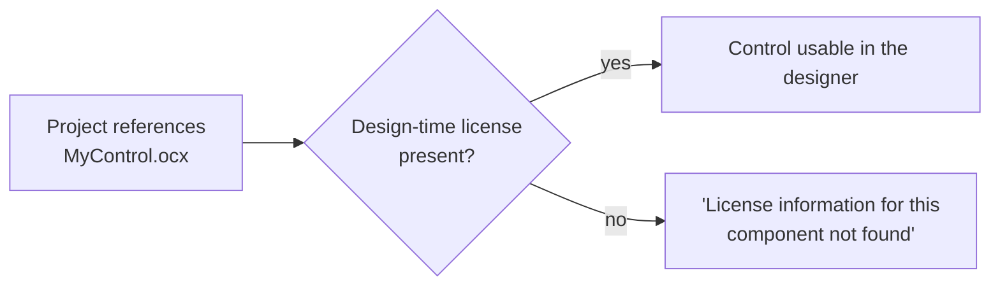

# Troubleshooting

Start with **`2-Verificar.bat`**. It reads the registry and the filesystem and prints one line per
check, with the path it is actually using. Most problems are visible there in five seconds.

```text
 Verificacion:
    OK     IDE VB6.EXE  D:\VB6-Anywhere\01_IDE\VB98\VB6.EXE
    OK     Path del IDE  -> D:\VB6-Anywhere\01_IDE\VB98
    OK     Marca de edicion
    OK     Controles base (6.0 y 5.0)
    OK     Runtime VBA (IDE)  -> C:\...\Common Files\Microsoft Shared\VBA\VBA6\3082\VBE6INTL.DLL
    OK     Registro VS6/VB6
```

---

## `No se puede encontrar el archivo 'DAO350.DLL'`

Shown by the IDE **right after the splash screen**, typically on a machine where VB6 was never
installed.

The default VB6 project carries a reference to the **DAO 3.51** library, so the IDE loads it while
starting. A real VB6 setup drops `DAO350.DLL` in the system directory and registers its type library
— whose version is **4.0**, even though the library is called "3.51". On a clean machine neither
exists, and the IDE stops here.

**Fix:** run `1-Instalar.bat`. It registers the copy shipped in `01_IDE\VB98\DAO350.DLL`, but **only
if** the machine has no working DAO 3.51 registration — an existing one is left untouched, so a
machine with Office or a real VB6 keeps using its own.

`2-Verificar.bat` reports it as `DAO 3.51 (IDE)`.

Two details worth knowing if you ever have to do it by hand:

- **`regsvr32 dao350.dll` does not work.** The DLL exports no `DllRegisterServer`.
- The registration must run **from a 32-bit process** (`LoadTypeLibEx` writes to the registry view of
  the calling process, and VB6 reads the 32-bit view). That is what
  `Herramientas\Registrar-Typelib.ps1` does, launched through
  `%WINDIR%\SysWOW64\WindowsPowerShell\v1.0\powershell.exe`.

---

## The IDE opens and closes immediately (but the VBA runtime **is** present)

On a machine that never had VB6 installed, this can still happen with every file in place. The IDE
does not only *load* `MSO97RT.DLL`, it **locates** it through the registry:

```
HKLM\SOFTWARE\WOW6432Node\Microsoft\Shared Tools\mso97rt\Path = <...>\Microsoft Shared\VBA\MSO97RT.DLL
```

A real VB6 installation writes that key; this package copies the DLL **and** registers it, but an
older copy of the package - or a machine where someone deleted the key - reproduces the symptom
exactly: splash, generic error, clean exit.

Fix: `1-Instalar.bat`. `2-Verificar.bat` reports it as `MSO97RT registrado`.

This was found on a virgin Windows 11 VM with an A/B test: with the key the IDE opens; removing it
brings the silent exit straight back.

---

## The IDE opens and closes immediately

**Message:** `Unexpected error; quitting` (English) or `Error inesperado. Se cerrará el programa`
(Spanish, when the IDE binaries are the Spanish build). No crash, exit code 0.

| Cause | Check | Fix |
|---|---|---|
| Shared VBA runtime missing | `Runtime VBA (IDE)` line in `2-Verificar.bat` | `1-Instalar.bat` |
| Package never installed in this machine | `Path del IDE` points elsewhere | `1-Instalar.bat` |
| Folder was moved | `Path del IDE` shows the old path | `1-Instalar.bat` from the new location |
| Mixed VB6 builds | compare versions, see below | replace with the consistent set |

```powershell
# all three must be 6.00.9782 / 6.0.9782
(Get-Item .\01_IDE\VB98\VB6.EXE).VersionInfo.FileVersion
(Get-Item .\01_IDE\VB98\VB6IDE.DLL).VersionInfo.FileVersion
(Get-Item .\01_IDE\VB98\VBA6.DLL).VersionInfo.FileVersion
```

This failure is diagnosed in detail in [`HOW-IT-WAS-MADE.md`](HOW-IT-WAS-MADE.md): it is not a
crash, the process leaves voluntarily through its own error handler.

---

## `Error al intentar tener acceso al registro del sistema`

The IDE was launched without elevation. VB6 writes to `HKLM` while starting (and while compiling).

Use `4-Abrir VB6.bat` — it asks for UAC. Launching `VB6.EXE` directly (or through a shortcut without
the *Run as administrator* flag) reproduces this.

---

## The IDE asks for a license for some control

That control is **not** part of this package. VB6's design-time licensing works like this:



Two common cases:

- **Microsoft controls that ship with VB6** — covered by this package.
- **Third-party controls** (grid/report/imaging components, vendor controls): install your own
  licensed copy. Some old ones do not use the registry at all but a file such as
  `C:\Windows\license.dat`; that file belongs to your license and is not distributed here.

After installing a third-party control, run `1-Instalar.bat` again so the VB6 registry is coherent
with the new registration.

---

## `Errores de carga … Form1.frm` when compiling or opening a project

The `.frm` (or `.vbp`) has **LF** line endings. VB6 requires **CRLF**.

```powershell
# find offenders
Get-ChildItem -Recurse -Include *.frm,*.vbp,*.bas,*.cls |
  Where-Object { (Get-Content $_.FullName -Raw) -notmatch "`r`n" } |
  Select-Object FullName
```

This is also why the repository ships a [`.gitattributes`](../.gitattributes): a clone on Linux or a
careless editor would otherwise rewrite them with LF.

---

## The toolbox is empty / controls appear greyed out

The ActiveX controls are not registered.

```powershell
.\2-Verificar.bat        # look at "Controles base (6.0 y 5.0)"
.\1-Instalar.bat         # re-registers the 3 bundled controls
```

Remember the IDE reads the toolbox from `HKCU` — if it is open, close it before re-running the
installer, then reopen.

---

## Compilation fails with a licence or disk error

- **`LNK1104` / device I/O error** — the `.vbp` is malformed. `Path32` must be on its own line, next
  to `ExeName32`; if it is appended after a section header such as `[MS Transaction Server]`, VB6
  ignores it and the linker fails.
- **`Permission denied` while writing the EXE** — the output folder is read-only, or the EXE is
  running. Close it and retry.

`Compilar.ps1` copies the project to `%TEMP%` before compiling, so a rejected write in your source
tree usually means the *output* folder, not the project.

---

## It worked yesterday, now nothing does

In order of likelihood:

1. The folder moved → `1-Instalar.bat`.
2. Another VB6/VBA installation overwrote the registry → `1-Instalar.bat`.
3. `9-Desinstalar.bat` was run (registry cleaned) → `1-Instalar.bat`.
4. A Windows update removed/replaced something in `Common Files\Microsoft Shared\VBA` →
   `1-Instalar.bat` copies it back.

---

## How to collect useful information for an issue

```bat
5-Diagnostico.bat
```

It writes `diagnostico.txt` **inside the package folder**, read-only: Windows build and language,
versions and hashes of the binaries, the shared VBA runtime with its language folders, the relevant
registry values, DAO, and any other VB6/VBA installation on the machine.

Attach that file, the output of `2-Verificar.bat`, and the exact message you see.

If the IDE exits silently, this is how to prove what it is missing (advanced, but decisive):

```powershell
# 1) is it a crash or a voluntary exit?
procdump.exe -accepteula -e -x <dump-folder> ".\01_IDE\VB98\VB6.EXE"
#    no dump file => voluntary exit => missing dependency, not a bug

# 2) what does it look for and not find?
procmon.exe   # filter: Process Name is VB6.EXE, Result is NAME NOT FOUND
#    a DLL searched across many directories = a failed LoadLibrary
```


---

## The IDE opens, but closes as soon as I load a project

Clean machine: does not happen. **Machine that already had VB6** (installed, or an older portable
copy): it can happen, and the IDE exits about two seconds after the form appears, sometimes without
any message.

Cause: the IDE inherits two things from the previous installation.

* `HKCU\Software\Microsoft\Visual Basic\6.0` - its per-user state (window layout, toolbox, recent
  projects).
* The **component cache** under `HKLM\SOFTWARE\WOW6432Node\Microsoft\Visual Basic\6.0`: one
  subkey per control, whose value is the path to that control's `.oca` file. On an old machine those
  paths point at folders that no longer exist (`C:\PROGRA~1\DataMask\bin`, `\\SERVER\...\Cambios`)
  or at a previous portable tree.

Fix: run **`6-Reparar IDE.bat`**. It backs up both keys to `%TEMP%`, clears the inherited state and the
dead cache entries, and re-runs the verification.

What is **not** the cause, having measured it: a missing `.oca` file next to the OCX (deleting them
changes nothing) and a wrong `Shared Tools` registration (that is the *IDE never opens* case, see
above).

---

## Double-clicking a `.vbp` gives errors, opening it from the IDE does not

Classic symptom, and it is not the project: it is **two copies of the IDE**.

`HKCR\VisualBasic.Project\shell\open\command` decides which `VB6.EXE` Windows runs when you
double-click a project. If that command still points at a **previous portable tree** (or at a real VB6
installation), Windows launches *that* copy, which has its own registry state, its own component cache
and its own `Path` - while the package you installed is a different folder. The IDE you open from the
shortcut uses the correct tree, so the same project works.

Check it with:

```powershell
(Get-ItemProperty 'Registry::HKEY_CLASSES_ROOT\VisualBasic.Project\shell\open\command').'(default)'
(Get-ItemProperty 'HKLM:\SOFTWARE\WOW6432Node\Microsoft\Visual Basic\6.0').Path
```

If the two paths are not the same tree, that is the bug. `1-Instalar.bat` now writes the association
to its own `VB6.EXE`, and `9-Desinstalar.bat` removes it only when it points into its own folder.

---

## `Component 'COMCTL32.OCX' ... not correctly registered`

`COMCTL32.OCX` is **not** `MSCOMCTL.OCX`. They are two different files that VB6 shipped:

| File | What it is | Type library |
|---|---|---|
| `MSCOMCTL.OCX` | Windows Common Controls **6.0** (`TreeView`, `ListView`, `Toolbar`...) | `{831FDD16-0C5C-11D2-A9FC-0000F8754DA1}` |
| `COMCTL32.OCX` | Windows Common Controls **5.0**, kept for older projects | `{6B7E6392-850A-101B-AFC0-4210102A8DA7}` |

A project whose `.vbp` contains `Object=...; COMCTL32.OCX` needs the 5.0 file. If only the 6.0 one is
registered, the IDE reports the component as missing even though "the common controls" look installed.

### It is also a version question: `#1.3#` vs `#1.5#`

VB6 does not match the file name, it matches **the type library version written in the `.vbp`**:

```
Object={6B7E6392-850A-101B-AFC0-4210102A8DA7}#1.5#0; COMCTL32.OCX
                                             ^^^ this is the typelib version
```

`COMCTL32.OCX` exists in two builds that register **different typelib versions**:

| File version | Type library | Where it comes from |
|---|---|---|
| 6.00.8022 | **1.3** | the VB6 installation media |
| 6.00.9839 | **1.5** | the later VB6/VS6 service packs |

A project that recorded `#1.5#` will **not** load with only 1.3 registered, and the message it shows
is the misleading *"Cannot load ...COMCTL32.OCX"* pointing at the project folder - even if the file is
sitting right there, because the lookup is by GUID + version, not by path. Proven by editing only the
stamp in a copy of the project: `#1.5#` fails, `#1.3#` opens.

Both builds are therefore bundled (`COMCTL32.OCX` and `COMCTL32_v15.OCX`) and both get registered, so
each project finds the version it asks for. `2-Verificar.bat` reports them together as
`Controles base (6.0 y 5.0)` and requires 1.3 **and** 1.5.

If you cannot reinstall right now and need that one project to open today, editing its `.vbp` from
`#1.5#` to `#1.3#` makes it load against the 1.3 build - at the cost of changing the project file.
